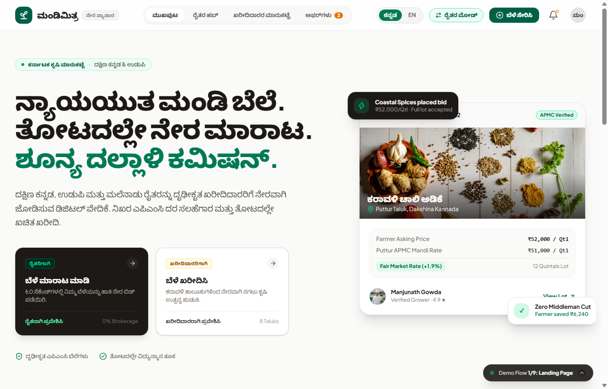
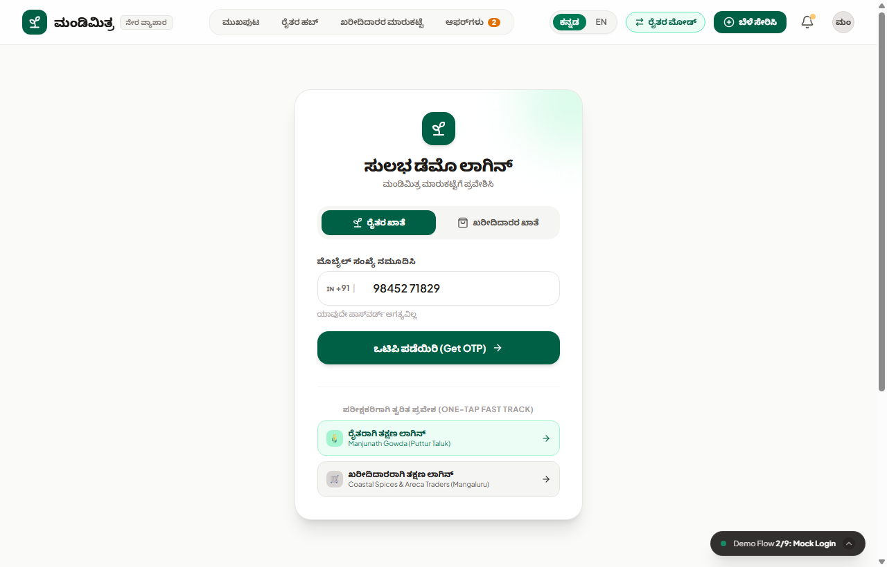
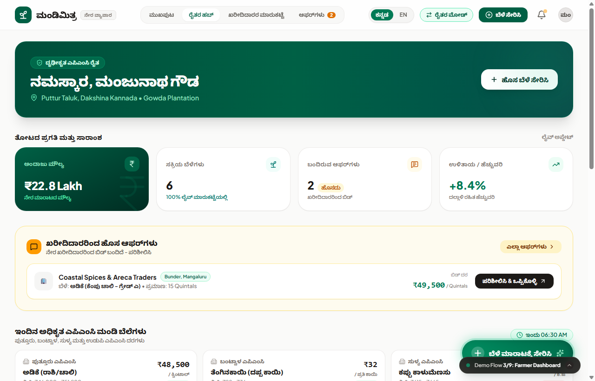
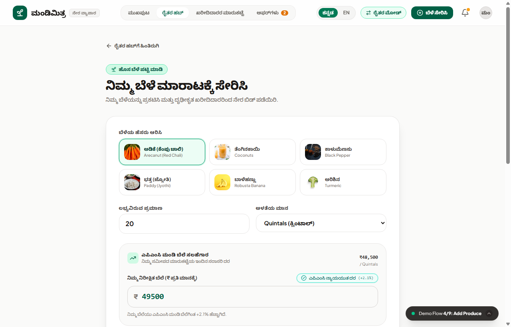
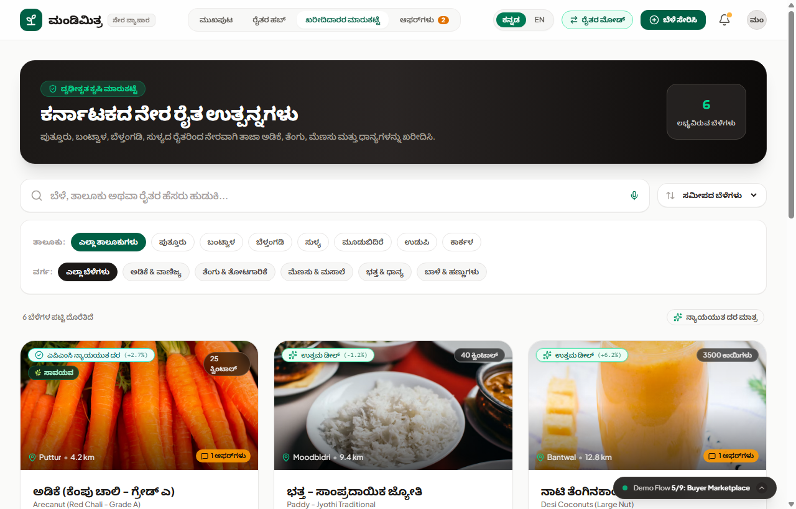
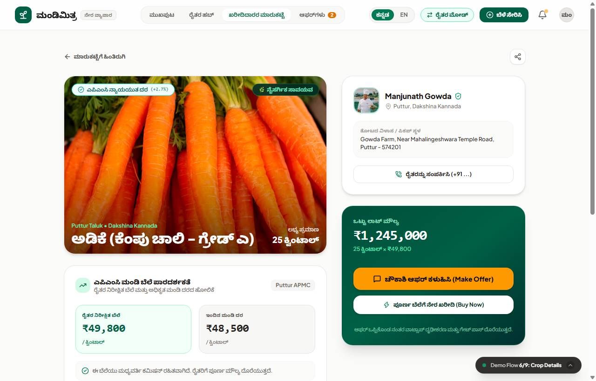
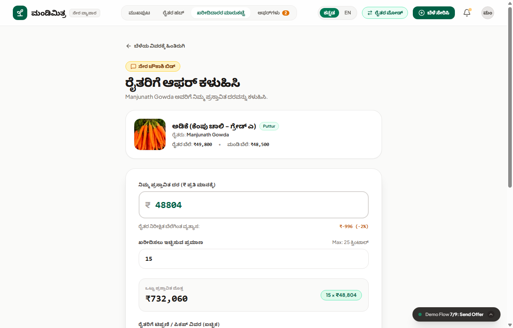
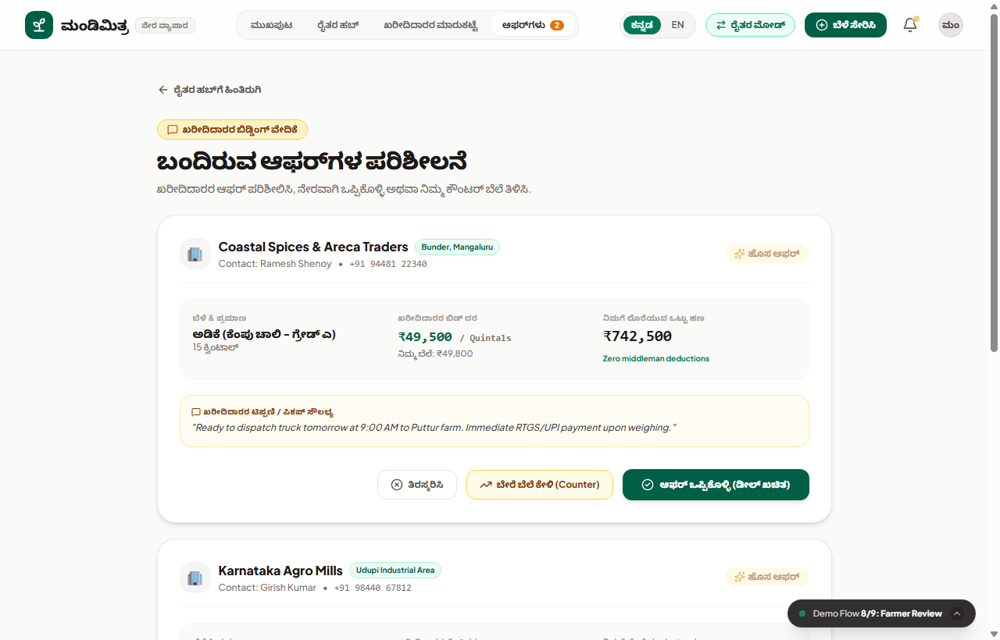
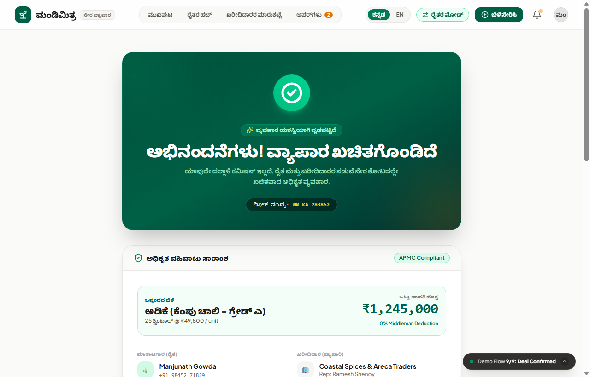

# 🌾 Mandi Mitra (ಮಂಡಿ ಮಿತ್ರ)

**A Kannada-first direct farmer-to-buyer marketplace with APMC price transparency for Karnataka agriculture.**

Built for **DevHost 2026 (Synergia '26), Problem Statement PS 1.2: Direct Market-Access Platform for Marginal Farmers.**

| | |
|---|---|
| **Live demo** | https://mandi-mitra-v1.vercel.app |

> **Note on data:** this is a client-side prototype. Prices, listings, farmers and buyers are **sample data** modelled on APMC mandi rates for Dakshina Kannada and Udupi. Login, voice search and farmer calling are simulated. Live Agmarknet integration and a real backend are the planned next step.

---

## Problem Statement

Smallholder farmers in Karnataka—producing high-value regional crops such as Arecanut (*ಅಡಿಕೆ*), Coconut (*ತೆಂಗಿನಕಾಯಿ*), Black Pepper (*ಕಾಳುಮೆಣಸು*), Jyothi Paddy (*ಭತ್ತ*), and Spices—face three structural challenges in traditional agricultural marketing:

1. **Information Asymmetry & Price Manipulation**: Commission agents and village middlemen conceal real-time APMC mandi modal rates. Farmers sell without knowing prevailing market prices, often losing ₹3,000–₹8,000 per quintal.
2. **Heavy Middleman Commissions & Delayed Payouts**: Intermediaries charge 6% to 12% in commissions and deduction cuts, coupled with arbitrary weighing adjustments and delayed payment cycles lasting weeks.
3. **Language & Digital Barriers**: Mainstream national agri-portals are predominantly in English or Hindi, with complex registration flows that intimidate rural farmers who require an intuitive Kannada-first vernacular interface.

### How MandiMitra Solves This

Mandi Mitra connects small producers directly to buyers and shows an APMC benchmark beside every listing, so both sides negotiate on facts.

- **Direct trade, no brokerage for farmers.** Farmers list produce from the farmgate and buyers bid directly.
- **APMC price benchmark.** Each asking price is compared with the APMC modal rate for nearby yards and tagged *Fair Price*, *Great Deal* or *Premium*.
- **Negotiation.** Buyers send custom price and quantity offers; farmers accept, counter or reject.
- **Deal confirmation.** An accepted deal generates a unique Deal ID (`MM-KA-XXXXXX`), a downloadable digital gate pass (`.txt`) and a ready-to-send WhatsApp trade message.
- **Kannada and English** across the whole interface.

---

## Features

### Farmer
- **Farmer hub (`/farmer`)**: overview of listings, pending bids and portfolio value.
- **Add produce (`/farmer/add`)**: one-tap crop chips for regional staples (arecanut, coconut, black pepper, paddy, banana, turmeric), regional units, pickup details, and a **price advisor** that benchmarks the asking price against the APMC rate as you type.
- **Offers (`/farmer/offers`)**: inbox of buyer bids with buyer name, location, price, quantity and notes; **Accept**, **Counter-offer** (revised price) or **Reject**.

### Buyer
- **Marketplace (`/buyer`)**: listing cards with harvest image, distance, asking price and lot size; filters for **taluk** (Puttur, Bantwal, Belthangady, Sullia, Moodbidri, Udupi, Karkala) and **crop category**; a **Fair Price Only** toggle; sorting by distance, price or newest; and **Kannada voice search (simulated)**.
- **Listing details (`/buyer/crop`)**: grade, lot value, farmgate address, a card comparing the asking price with the APMC benchmark, a simulated call button, and **Instant Buy** or **Submit Offer**.
- **Offer screen (`/buyer/offer`)**: price and quantity inputs with live difference from the asking price (₹ and %), total payout and a pickup note.

### Platform
- **Bilingual toggle** (`ಕನ್ನಡ / EN`) for all text, labels and badges.
- **Mock login (`/login`)**: simulated phone and OTP, plus one-tap fast-track buttons for a sample Farmer or Buyer.
- **Demo controller dock**: a floating button to jump to any of the 9 demo stages or switch roles.
- **Deal confirmed (`/deal-confirmed`)**: confetti, Deal ID, downloadable gate pass and WhatsApp dispatch.
- **Sample APMC price ticker** for major Karnataka yards.
- **Bilingual toast notifications** for actions such as bids, calls and downloads.

---

## Prototype Flow

The prototype provides a complete, cohesive 9-stage end-to-end user journey:

```
Landing → Login (Farmer / Buyer)
            │
   ┌────────┴─────────┐
   ▼                  ▼
Farmer dashboard   Buyer marketplace
   │                  │
Add produce        Listing details
(price advisor)       │
                   Submit offer
   ┌──────────────────┘
   ▼
Farmer reviews offer → Accept / Counter / Reject
   ▼
Deal confirmed → Deal ID + gate pass + WhatsApp message
```

---

## Screenshots

### 1. Landing Page

*Bilingual hero section featuring Karnataka agricultural focus, live APMC price ticker, dual role entry points, and 0% commission guarantee.*

---

### 2. Mock Login & Fast-Track Access

*Simulated OTP login with dedicated One-Tap Fast Track buttons for immediate evaluation as either Farmer or Buyer.*

---

### 3. Farmer Dashboard

*Farmer hub displaying portfolio valuation, active listings, incoming buyer bids, middleman savings counter, and APMC benchmark feed.*

---

### 4. Add Produce Flow

*Produce listing form with one-tap regional crop chips, quantity inputs, and the real-time APMC Benchmark Price Advisor.*

---

### 5. Buyer Marketplace

*Direct crop marketplace with taluk filters, crop categories, "Fair Price Only" toggle, and simulated Kannada voice search.*

---

### 6. Listing Details

*Detailed harvest view highlighting APMC price benchmark comparison, farmgate location, simulated direct farmer calling, and bidding options.*

---

### 7. Buyer Offer Submission Screen

*Interactive bidding screen showing real-time price variance calculations against the farmer's asking rate and total lot payout.*

---

### 8. Farmer Offer Review & Counter-Offer

*Farmer offer inbox with options to review buyer bids, propose counter-offers, or accept deals directly.*

---

### 9. Deal Confirmation & Gate Pass

*Deal confirmation screen with confetti animation, official Deal ID, client-side downloadable Digital Gate Pass (`.txt`), and WhatsApp dispatch.*

---

## Tech Stack

| Layer | Tools |
|---|---|
| Framework | SvelteKit 2, Svelte 5 (runes) |
| Language | TypeScript |
| Styling | Tailwind CSS v4, Lucide icons |
| State | Svelte stores synced to `localStorage` |
| Data | Sample Karnataka crop, listing and APMC-rate datasets (`src/lib/mockData.ts`) |
| i18n | Kannada and English dictionary (`src/lib/i18n.ts`) |
| Extras | canvas-confetti, client-side gate pass download, WhatsApp deep link |
| Build and hosting | Vite, Vercel |

---

## Getting started

Requires Node.js 18 or newer.

```bash
git clone https://github.com/Tanushree-RD/MandiMitra.git
cd MandiMitra
npm install
npm run dev
```

Open `http://localhost:5173/`. On the login page, use a fast-track button to enter as a Farmer or Buyer.

Other commands:

```bash
npm run check     # type checks
npm run build     # production build
npm run preview   # preview the build locally
```

## Project structure

```
MandiMitra/
├── src/
│   ├── lib/
│   │   ├── components/        # Navbar, ProduceCard, FilterChips, SearchBar, PriceComparisonBadge, ...
│   │   ├── stores/appStore.ts # listings, offers, role and language state
│   │   ├── i18n.ts            # Kannada / English translations
│   │   ├── mockData.ts        # sample crops, listings and APMC rates
│   │   └── types.ts
│   └── routes/                # landing, login, farmer/*, buyer/*, deal-confirmed
├── static/screenshots/
├── package.json
├── svelte.config.js
└── vite.config.ts
```

## Limitations and next steps

- Prices and listings are sample data. **Next:** integrate live Agmarknet mandi prices (data.gov.in) with caching.
- Login, voice search and calling are simulated. **Next:** real phone OTP login and speech recognition.
- State lives in the browser. **Next:** a backend and database so farmers and buyers share live data.
- Planned: SMS/WhatsApp alerts through an API, and onboarding through FPOs and cooperatives.
- Impact figures such as farmer savings are to be **validated in a pilot**, not claimed here.

## Scalability

Onboard farmers through FPOs, cooperatives and Krishi Kendras. Because Agmarknet covers mandis nationwide, a new district mainly needs a language pack and local buyers. Later use cases include fish and aquaculture produce, dairy, and logistics booking.

## Team

| Name |
|---|
| `Tanushree` (Team Leader) |
| `Purab Rohan` |
| `Manish Stalon Dsouza` |

College: `St Joseph Engineering College`
